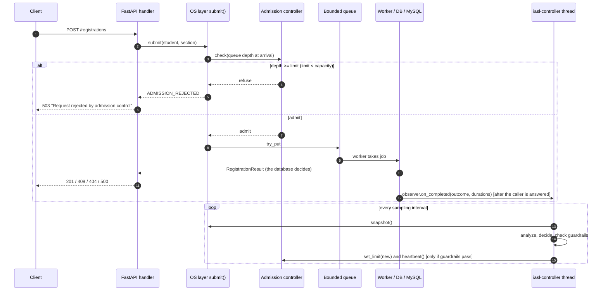

# IASL Architecture (as built)

| | |
|---|---|
| **Status** | **Implemented.** This document began as the Stage 1 proposal and has been reconciled with the code under `app/iasl/`, `app/iasl_api.py` and the hooks in `app/os_layer/request_pipeline.py`. Where the build differs from the proposal, the difference is noted. |
| **Evidence base** | `IASL_IMPLEMENTATION_AUDIT.md` (the repository before IASL, with file/function citations). |
| **Companions** | `IASL_DESIGN.md` (interfaces, algorithms, as-built notes), `IASL_CONFIGURATION.md` (settings), `IASL_TESTING.md` (test record), `IASL_EXPERIMENTS.md` (measured evaluation). |
| **Performance claims** | **None are made here.** What was measured, and what it did and did not show, is in `IASL_EXPERIMENTS.md`. |

Labels: **Implemented** (exists, with the file it lives in) · **Not built** (explicitly out of v1).

---

## 1. Why IASL, and what it can honestly do

ConcurrentReg already bounds work with a fixed queue, a fixed worker pool and a fixed DB semaphore. Those limits are set once at start-up and cannot react to load. When a burst arrives, the queue fills to its fixed capacity and every waiting request pays the full queueing delay.

IASL adds a closed feedback loop that observes the layer and moves **one** parameter, the *admission depth limit*, between a safe floor and the queue's physical capacity.

**What this can and cannot do (the design's stated expectation, so the experiments are judged fairly):**

* Throughput is bounded by the database (row lock on a hot section) and the DB semaphore. **A limit in front of the queue cannot raise throughput capacity.**
* It can trade refusals for lower queueing delay: a shorter effective queue means a shorter wait for admitted requests.
* Lowering latency by refusing more requests is **not** by itself an improvement. Evaluation reports refusal rate and goodput next to latency (`IASL_EXPERIMENTS.md`).
* With the default queue capacity (16) and 4 workers the controllable range is narrow; a larger capacity is needed for a meaningful control range.

---

## 2. Position in the system

```
                     CLIENTS  (workload generator, external process)
                        |   POST /registrations
                        v
        FastAPI handler            app/main.py  create_registration()
                        |   layer.submit(student_id, section_id)
                        v
 +----------------------------------------------------------------------------------+
 | OSConcurrencyLayer.submit()    app/os_layer/request_pipeline.py                  |
 |                                                                                  |
 |    +--------------------------+     +---------------------------------+          |
 |    |  ADMISSION CONTROLLER    | <-- |  limit (one int) + heartbeat    |          |
 |    |  app/iasl/admission.py   |     |  written only by the IASL loop  |          |
 |    |  admit iff depth < limit |     +----------------^----------------+          |
 |    |  O(1), no I/O, no lock   |                      |                           |
 |    +-----------+--------------+                      |                           |
 |        admit   |   refuse -> ADMISSION_REJECTED      |                           |
 |                v                                     |                           |
 |        BOUNDED QUEUE  (fixed capacity, FIFO)         |                           |
 |                v                                     |                           |
 |        WORKER POOL  (fixed N threads)                |                           |
 |                v                                     |                           |
 |        DB SEMAPHORE  (fixed permits)                 |                           |
 |                v                                     |                           |
 |        register_student()  -- one transaction, SELECT ... FOR UPDATE             |
 |                v                                     |                           |
 |        MySQL / InnoDB  (CHECK + UNIQUE)              |                           |
 +----------------------------------------------------------------------------------+
         | snapshot() + outcome observer (OutcomeRecorder)  ^
         v                                                  |
 +----------------------------------------------------------------------------------+
 |  IASL   app/iasl/   (thread "iasl-controller", off the request path)             |
 |                                                                                  |
 |   1 MetricsCollector --> 2 StateAnalyzer --> 3 decision engine (engine.py)       |
 |      metrics.py            analyzer.py                  |                         |
 |                                  4 guardrails.py <------+                         |
 |                                         |                                        |
 |                      controller.py  AdaptiveController (owns the parameter) -----+
 |                                         |                                        |
 |                              Decision log (bounded)                              |
 +----------------------------------------------------------------------------------+
         | read-only HTTP (app/iasl_api.py): /iasl/status  /iasl/metrics  /iasl/decisions  /iasl/config
         v
     operators, dashboard, experiment recorder
```

The brief's diagram also lists a **Request Filtering / Classification** box. It has no counterpart in the repository and no requirement beyond the picture; it is **not built** in v1.

### 2.1 What IASL is allowed to touch

| IASL may | IASL may never |
|---|---|
| Read `OSConcurrencyLayer.snapshot()` | Import or call `registration_service`, `models`, `database`, `seed`, any SQL library or `os_layer` (enforced by `tests/test_iasl_boundary.py`) |
| Receive completion callbacks from the layer (outcome code and durations only) | Open a DB session, run SQL, or read InnoDB tables |
| Publish one integer: the admission depth limit | Resize the queue, workers or semaphore (unsupported by those classes; not attempted) |
| Cause `submit()` to refuse a request **before** it is queued | Treat an admission decision as a registration result |
| Write its own decision log and expose it read-only | Change thresholds or limits over HTTP (there is no write endpoint) |

The database remains the sole authority on seats, duplicates and consistency. An admitted request still passes through the unchanged Day 1 transaction.

**The OS layer does not import IASL.** `OSConcurrencyLayer.__init__(config, admission=None, observer=None)` takes the two hooks as duck-typed objects (`admission.check(queue_depth) -> bool`; `observer.on_completed(code, queue_wait_s, db_section_s, server_s)` and `observer.on_cancelled()`); `app/iasl/runtime.py` installs them. `tests/test_iasl_boundary.py` also asserts that nothing under `app/os_layer/` imports `app.iasl`.

---

## 3. Request lifecycle: five distinct stages

These are never conflated; each has its own counter.

| # | Stage | Meaning | Counter (source) |
|---|---|---|---|
| 1 | **Received** | `submit()` was called | derived: the sum of the outcomes of the next two rows |
| 2 | **Refused** | admission control, the full queue, or shutdown turned it away | `admission.rejected` (layer, **new**), `queue.rejected_queue_full`, `queue.rejected_shutting_down` (existing) |
| 3 | **Queued** | entered the bounded queue | `queue.accepted` (existing) |
| 4 | **Processing started** | a worker took it | `workers.jobs_started` (existing) |
| 5 | **Completed** with an outcome | `SUCCESS`, `DUPLICATE`, `FULL`, `STUDENT_NOT_FOUND`, `SECTION_NOT_FOUND`, `ERROR`, or `CANCELLED` (the caller gave up while it was queued) | per-outcome counts in `OutcomeRecorder.counters()` (**new**, `app/iasl/telemetry.py`; read by the collector for the error rate, not a separate endpoint) |

"Accepted" in the existing code already meant *entered the queue*, not *will succeed*; IASL keeps that meaning. Note `workers.jobs_finished` is incremented slightly after the caller is answered and also counts cancelled jobs.

---

## 4. Threads and data flow

| Thread | Does | Touches IASL state |
|---|---|---|
| Event loop (uvicorn) | `create_registration` -> `submit()` -> **admission check** | reads the limit, the fallback flag and the heartbeat time (plain attribute reads and one clock read) |
| Worker threads (N) | `_process` -> semaphore -> transaction | after answering the caller, tells the **observer** (one short lock: a counter and a ring append); exceptions are logged once and ignored |
| `iasl-controller` (one daemon thread) | every `IASL_SAMPLING_INTERVAL_S`: sample -> analyze -> decide -> guard -> apply -> log | the only writer of the limit |
| HTTP handlers for `/iasl/*` | read the immutable snapshot published by the last tick (decisions: a short-lock copy of the bounded log) | read-only; they never call into the OS layer |



The feedback loop maps one-to-one onto the loop thread:

```
 SYSTEM EXECUTION --> COLLECT METRICS --> ANALYZE STATE --> DECIDE --> CHECK SAFETY --> APPLY --> OBSERVE (next tick)
   (layer)             (collector)         (analyzer)      (engine)   (guardrails)    (controller)
```

---

## 5. The one control parameter

**`admission_depth_limit` (L)**: a request is admitted only if the number already waiting in the queue is below L. Range `[L_min, L_max]` with `L_max = queue capacity`. At `L = L_max` the check is skipped entirely and behaviour is **identical to running without IASL** (the queue's own full-queue refusal, message and HTTP mapping are untouched).

Why this and not an in-flight-concurrency limit or a rate limiter (comparison in Design section 3):

* It needs **no completion bookkeeping on the request path**. An in-flight counter must be decremented on every exit including cancelled and failed jobs; one missed path leaks admission slots permanently. The queue depth is already maintained by the standard library.
* It is O(1) and lock-free on the event loop.
* It directly bounds queueing delay (wait is about depth x service time).

Known limitations, both tested and documented rather than hidden:

* It limits *waiting*, not *running*. Requests already holding workers are unaffected.
* **The bound is exact only with one submitting thread**, which is how production runs (`submit()` is called from the single event-loop thread). If several threads call `submit()` at once they can all pass the depth check before any of them enqueues, so the queue can overshoot the limit by at most (number of submitters - 1); the queue's own capacity remains a hard bound either way (`test_with_one_submitter_the_limit_is_exact_and_with_many_it_overshoots_by_at_most_the_number_of_submitters`).

---

## 6. Safety architecture

Layered so that every failure falls back to a state that already passed the existing test suite (the fixed, bounded layer):

1. **Disabled by default.** `IASL_ENABLED` absent or false: no controller thread, no hook installed, `submit()` takes the original code path, and `/os-layer/status` has no `admission` block.
2. **Hard bounds at the point of use.** `AdmissionController.set_limit` itself refuses any value outside `[1, capacity]`, independent of what the decision logic computed.
3. **Single writer, bounded steps, cooldown, reversal lockout, oscillation hold.** Enforced by `guardrails.py` before any apply.
4. **Fail-open on hook errors.** If the admission check raises, the request is admitted (the bounded queue still protects the system). If the observer raises, it is logged once and ignored; the request is unaffected.
5. **Watchdog on the request path.** The admission controller stores the time of the last controller heartbeat. If the loop thread dies or stalls, the next `check()` notices (`now - heartbeat > IASL_WATCHDOG_SECONDS`) and uses the fallback limit with no help from the dead thread.
6. **Fallback mode.** After repeated tick failures, or repeated untrusted (invalid, stale or degraded) samples, the limit moves to the configured fallback (default: queue capacity = pre-IASL behaviour). Leaving it requires several consecutive healthy ticks.
7. **Isolation from correctness code**, verified by an import-boundary test.

Failure matrix (full version in Design section 9):

| Failure | Result |
|---|---|
| IASL disabled | Original behaviour exactly |
| Controller thread crashes or stalls | Watchdog -> fallback limit; registrations unaffected |
| Metrics stale, invalid or degraded | State held and the limit never raised; after `IASL_FALLBACK_AFTER_DEGRADED` consecutive untrusted ticks (default 10) fallback is entered; logged |
| Admission check raises | Admit; logged once |
| Observer raises | Ignored; logged once |
| Layer replaced via `/demo/os-layer` | IASL re-attaches to the new layer, resets its history, a `RESET` decision is recorded, the counter drop is treated as a restart |
| Invalid configuration | Server refuses to start, naming the variable (existing convention) |

---

## 7. Integration surface (the complete list as built)

Everything outside `app/iasl/` that changed or was added:

| File | Change | Behaviour when IASL is disabled |
|---|---|---|
| `app/os_layer/request_pipeline.py` | `__init__` takes optional `admission=None`, `observer=None`; `submit()` consults `admission` where the old placeholder comment was (skipped on a shut-down queue); `_process` tells `observer` after the Future is resolved and on a cancelled job; `snapshot()` adds an additive `"admission"` block (`enabled`, `rejected`, `limit`, `configured_limit`, `fallback`, `watchdog_tripped`); new result `ADMISSION_REJECTED` | unchanged: no block, same counters, same behaviour |
| `app/main.py` | `create_app(os_config=None, iasl_config=None)`; build/attach/start/stop in `lifespan`; `HTTP_STATUS[ADMISSION_REJECTED] = 503`; includes the `/iasl` router; keeps `app.state.iasl` and `app.state.iasl_config` | unchanged |
| `app/iasl_api.py` (new) | the four read-only `GET /iasl/*` endpoints | answer "switched off" |
| `app/demo_api.py` | `counters()` counts admission refusals as progress; result files record `server.iasl`; `reconfigure_os_layer` re-attaches IASL to the new layer | unchanged outputs (`server.iasl` is `{"enabled": false}`) |
| `workload/workload_generator.py` | category `ADMISSION_REJECTED` and its `KNOWN_RESPONSES` entry; `arrival_offsets` untouched | unchanged outputs |
| `frontend/src/lib/types.ts`, `theme.ts`, `results.ts` | the new category added (additive) | n/a |
| `tests/conftest.py` | `start_server(os_config, iasl_config=None)`, defaulting to an explicitly disabled IASL | n/a |
| `tests/iasl_enabled_plugin.py`, `scripts/iasl_*.py` (new) | test plugin and experiment tooling; the product never imports them | n/a |

**Untouched:** `registration_service.py`, `models.py`, `database.py`, `db_semaphore.py`, `bounded_queue.py`, `worker_pool.py`, `layer_config.py` (`OSLayerConfig` gained no fields: an existing test asserts its exact shape), `seed.py`, `schemas.py`, `verification.py`, and every pre-existing test. README and documentation statements that said IASL does not exist are updated separately.

---

## 8. Package layout (as built)

```
app/iasl/
  __init__.py
  types.py        enums and frozen dataclasses (MetricQuality, SystemState, MetricsSample, Assessment, ControlParameter, Decision, ...)
  config.py       IASLConfig: parsing, validation, defaults, resolve_bounds, fallback_limit
  telemetry.py    OutcomeRecorder: per-outcome counters + bounded latency window (the only request-path writes)
  metrics.py      MetricsCollector: snapshot + recorder -> MetricsSample (deltas, quality, restart)
  analyzer.py     StateAnalyzer: signals -> HEALTHY / UNDER_PRESSURE / OVERLOADED, hysteresis
  engine.py       decide(): pure rules -> one ProposedAction + reason
  guardrails.py   review() and after_applied(): bounds, step, cooldown, reversal lockout, oscillation
  controller.py   AdaptiveController: owns the parameter, validates, applies, records, fallback
  admission.py    AdmissionController: the O(1) request-path check, watchdog, fallback flag
  runtime.py      IASLRuntime: wiring, loop thread, attach, published snapshot
  serialize.py    plain-dict views of the immutable objects for the API
app/iasl_api.py   read-only router (naming matches app/demo_api.py)
```

Dependency direction (no cycles; nothing under `app/iasl/` imports registration, database, SQL or OS-layer code):

```
types <- config
types <- telemetry
types, config, telemetry <- metrics <- analyzer <- engine <- controller
config, types <- guardrails <- controller
admission  (depends only on the clock)
serialize  (depends only on types)
runtime  -> all of the above;   iasl_api -> runtime, serialize, config (read-only)
request_pipeline -> (nothing in app.iasl): hooks are duck-typed objects installed by runtime.attach()
```

---

## 9. Implemented and not built

| Item | Status |
|---|---|
| Admission controller, outcome observer hooks, metrics, analyzer, engine, guardrails, controller, runtime | **Implemented** (files above) |
| Read-only `/iasl/status`, `/iasl/metrics`, `/iasl/decisions`, `/iasl/config` | **Implemented** (`app/iasl_api.py`) |
| Request filtering / classification | **Not built** |
| Queue / worker / semaphore resizing | **Not built**: those classes cannot be resized safely at run time |
| Server-side request timeout (so timeout rate, DB timeouts and lock waits are reported as *unavailable*, never invented) | **Not built** |
| Runtime-write endpoint (settings are environment-only) | **Not built, by decision** |
| ML / LLM / RL policy | **Not built**: v1 is deterministic and rule-based, as a baseline for any later research |
| Multi-process deployment (all counters are per process) | **Not supported** |

See `IASL_DESIGN.md` for the detailed design and the as-built reconciliation, and `IASL_EXPERIMENTS.md` for what was measured.
